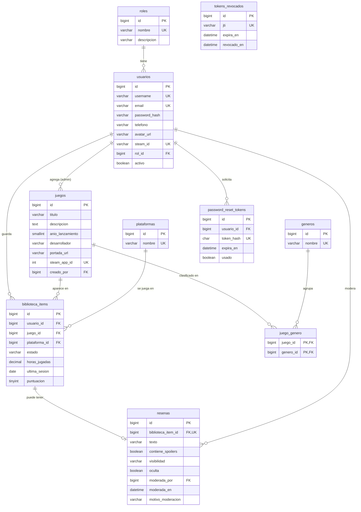

# ▣ PixelVault

> *Los buenos juegos merecen una partida guardada.*

**PixelVault** es una aplicación web full stack con estética retro-pixel para gestionar colecciones personales de videojuegos. Permite a los jugadores llevar el control de su biblioteca personal (estado de partida, horas jugadas, última sesión, calificación de 1 a 5 corazones y reseñas personales), con autenticación segura mediante JWT, control de acceso basado en roles y paginación/filtros del lado del servidor.

---

## 👥 Equipo

| Integrante | Usuario GitHub | Rol en el Proyecto |
| :--- | :--- | :--- |
| **Uriel Espinoza de la Rosa** | [@Uriel-tech302](https://github.com/Uriel-tech302) | Frontend (React + Vite), Diseño UI/UX (Figma) e Integración |
| **Kevin Nava Peralta** | [@kp720](https://github.com/kp720) | Backend (Spring Boot), Base de Datos (MySQL/Flyway) y Despliegue |

---

## 🔗 Enlaces del Proyecto

* **Aplicación en producción (HTTPS):** https://pixelvault-ito.duckdns.org/login
* **URL Base de la API (Producción):** https://pixelvault-ito.duckdns.org/api
* **URL Base de la API (Local):** `http://localhost:2727/api` *(configurable mediante `PORT`)*
* **Tablero Kanban (GitHub Projects):** https://github.com/users/Uriel-tech302/projects/3
* **Prototipo Navegable en Figma:** https://www.figma.com/proto/KjpV1Zpm1YZWyqYqksQEoi/Tarea?node-id=21-81&t=3QqDub9YTm2iGX1U-1&scaling=min-zoom&content-scaling=fixed&page-id=0%3A1&starting-point-node-id=21%3A81&show-proto-sidebar=1

---

## 🛠️ Stack Tecnológico

| Capa | Tecnologías |
| :--- | :--- |
| **Frontend** | React, Vite, React Router DOM, Axios (interceptores JWT), Context API, CSS3 responsivo |
| **Backend** | Java 21, Spring Boot 4.1.2, Spring Security, JJWT 0.12.6, Spring Data JPA (Hibernate 7.4), Bean Validation |
| **Base de Datos** | MySQL 8, Flyway (migraciones versionadas `V1`–`V3`) |
| **Pruebas de API** | Bruno (colecciones con autenticación automática y casos de éxito/error) |
| **Despliegue** | VPS Ubuntu (Hetzner Cloud), Nginx, `systemd`, Let's Encrypt (Certbot HTTPS), Postfix (SPF/DKIM) |

---

## 📁 Estructura del Repositorio

```text
PixelVault/
├── backend/
│   ├── final/                  # Proyecto Spring Boot (Maven, src/, Flyway migrations)
│   ├── bruno-paso3/            # Colección de pruebas Bruno (Catálogo y Biblioteca)
│   └── bruno-paso3b/           # Colección de pruebas Bruno (Administración de Catálogo)
├── frontend/                   # Aplicación React + Vite
├── docs/                       # Documentación de contratos de API y diagrama ER
└── README.md
```

---

## 🗄️ Modelo de Datos (Diagrama ER)

El esquema cuenta con **11 tablas** gestionadas mediante migraciones de **Flyway** (`backend/final/src/main/resources/db/migration/`):
* `V1__schema.sql`: Tablas principales, claves foráneas, restricciones `UNIQUE` y relación N:M (`juego_genero`).
* `V2__perfil_telefono.sql`: Soporte para datos de perfil y códigos de acceso/recuperación.
* `V3__seed.sql`: Datos semilla iniciales (3 roles, 5 plataformas, 10 géneros y 15 videojuegos del catálogo).



---

## 🔐 Roles, Permisos y Credenciales de Prueba

### Matriz de permisos

| Recurso | `ADMIN` | `MODERADOR` | `USUARIO` |
| :--- | :---: | :---: | :---: |
| Catálogo de juegos, géneros y plataformas | Crear, editar y eliminar | Solo ver | Solo ver |
| Gestión de usuarios y roles (`/api/admin/**`) | Administrar | No | Solo su perfil |
| Moderación de reseñas (`/api/moderacion/**`) | Ocultar y eliminar | Ocultar y eliminar | No |
| Biblioteca personal (`/api/biblioteca/**`) | Sí | Sí | Sí |

### Usuarios de prueba

Las cuentas semilla se crean automáticamente al arrancar el backend mediante `DataSeeder.java` (con contraseñas cifradas usando **BCrypt** y leídas desde variables de entorno; nunca se almacenan credenciales reales en el repositorio):

| Rol | Correo electrónico | Contraseña |
| :--- | :--- | :--- |
| **ADMIN** | `admin@pixelvault.com` | `12345SSs+` |
| **MODERADOR** | `moderador@pixelvault.com` | `12345SSs+` |
| **USUARIO** | `usuario@pixelvault.com` | `12345SSs+` |

---

## 🚀 Instalación y Ejecución Local

### Prerrequisitos
* **Java 21** (JDK 21)
* **Node.js 18+** y **npm**
* **MySQL 8.0+**

### 1. Clonar el repositorio
```bash
git clone https://github.com/Uriel-tech302/PixelVault.git
cd PixelVault
```

### 2. Preparar la base de datos MySQL
Conéctate a MySQL como administrador y crea el esquema:
```sql
CREATE DATABASE pixelvault CHARACTER SET utf8mb4 COLLATE utf8mb4_unicode_ci;
```
*(Al iniciar el backend, Flyway aplicará automáticamente las migraciones `V1`, `V2` y `V3`.)*

### 3. Configurar y ejecutar el Backend (Spring Boot)
El archivo `backend/final/src/main/resources/application.properties` lee las credenciales desde variables de entorno. En Windows (PowerShell), desde `backend/final`:

```powershell
cd backend\final

# Base de datos y JWT
$env:DB_PASS = '<tu_password_mysql>'
$b = New-Object byte[] 32
[Security.Cryptography.RandomNumberGenerator]::Create().GetBytes($b)
$env:JWT_SECRET = [Convert]::ToBase64String($b)

# Credenciales de usuarios semilla (DataSeeder)
$env:SEED_ADMIN_PASSWORD = '<password_admin>'
$env:SEED_MODERADOR_PASSWORD = '<password_moderador>'
$env:SEED_USUARIO_PASSWORD = '<password_usuario>'

# Correo (SMTP para recuperación de contraseña)
$env:MAIL_HOST = 'smtp.gmail.com'
$env:MAIL_PORT = '587'
$env:MAIL_USER = '<tu_correo@gmail.com>'
$env:MAIL_PASS = '<tu_clave_de_aplicacion>'
$env:MAIL_STARTTLS = 'true'
$env:MAIL_FROM = '<tu_correo@gmail.com>'

# API de Steam
$env:STEAM_API_KEY = '<tu_steam_api_key>'

# Arrancar Spring Boot (puerto 2727)
.\mvnw.cmd clean spring-boot:run
```

### 4. Configurar y ejecutar el Frontend (React + Vite)
En otra terminal, desde `frontend`:

```powershell
cd frontend
npm install
npm run dev
```

*(Opcional: crea un archivo `frontend/.env` con `VITE_API_URL=http://localhost:8080/api` si utilizas un puerto distinto en el backend).*

La aplicación estará disponible en **`http://localhost:5173`**.

---

## 📡 Endpoints Principales de la API

Todas las rutas protegidas requieren el encabezado `Authorization: Bearer <token>`.

### Autenticación (`/api/auth`)
* `POST /api/auth/register` — Registro de usuario (`201 Created`).
* `POST /api/auth/login` — Inicio de sesión con soporte de `recordarme` (`200 OK`, devuelve JWT).
* `POST /api/auth/logout` — Cierre de sesión con invalidación de token en `tokens_revocados` (`204 No Content`).
* `GET /api/auth/me` — Información del usuario autenticado.
* `POST /api/auth/forgot-password` / `POST /api/auth/reset-password` — Flujo de recuperación de contraseña.

### Catálogo (`/api`)
* `GET /api/juegos` — Listado paginado con búsqueda (`q`), filtro por género (`generoId`) y ordenamiento (`sort`).
* `GET /api/juegos/{id}` — Detalle de un videojuego del catálogo.
* `POST / PUT / DELETE /api/juegos` — Administración del catálogo *(solo rol `ADMIN`)*.
* `GET /api/generos` y `GET /api/plataformas` — Listados para selectores.

### Biblioteca Personal (`/api/biblioteca`)
* `GET /api/biblioteca` — Listado paginado del lado del servidor con filtros (`estado`, `plataformaId`, `q`, `page`, `size`, `sort`).
* `GET /api/biblioteca/resumen` — Estadísticas globales (`totalJuegos`, `horasTotales`, `porcentajeCompletado`, `porEstado`).
* `GET /api/biblioteca/{id}` — Detalle de entrada en la biblioteca personal.
* `POST /api/biblioteca` — Agregar juego del catálogo a la bóveda personal.
* `PUT /api/biblioteca/{id}` — Actualizar estado, horas jugadas, última sesión y puntuación (1–5).
* `DELETE /api/biblioteca/{id}` — Eliminar juego de la biblioteca personal.

---

## 🧪 Pruebas con Bruno

El repositorio incluye colecciones de **Bruno** listas para validar autenticación, paginación, filtros y códigos de error (`400`, `401`, `403`, `404`, `409`, `422`):
1. Abre **Bruno** y selecciona **Open Collection**.
2. Carga las carpetas `backend/bruno-paso3/` o `backend/bruno-paso3b/`.
3. Selecciona el entorno `local` (o configura `baseUrl` como `https://pixelvault-ito.duckdns.org` para probar contra producción) y define las contraseñas (`adminPassword`, `moderadorPassword`, `usuarioPassword`).

---

## 🛡️ Medidas de Seguridad Implementadas

* Contraseñas cifradas con **BCrypt** (validación de complejidad tanto en frontend como en backend).
* Autenticación **stateless** con JWT firmados y tabla de revocación para `logout`.
* Manejo centralizado de errores en JSON (`@ControllerAdvice`) sin exponer trazas ni entidades JPA directamente.
* Secretos y contraseñas inyectados exclusivamente por variables de entorno (fuera del control de versiones).